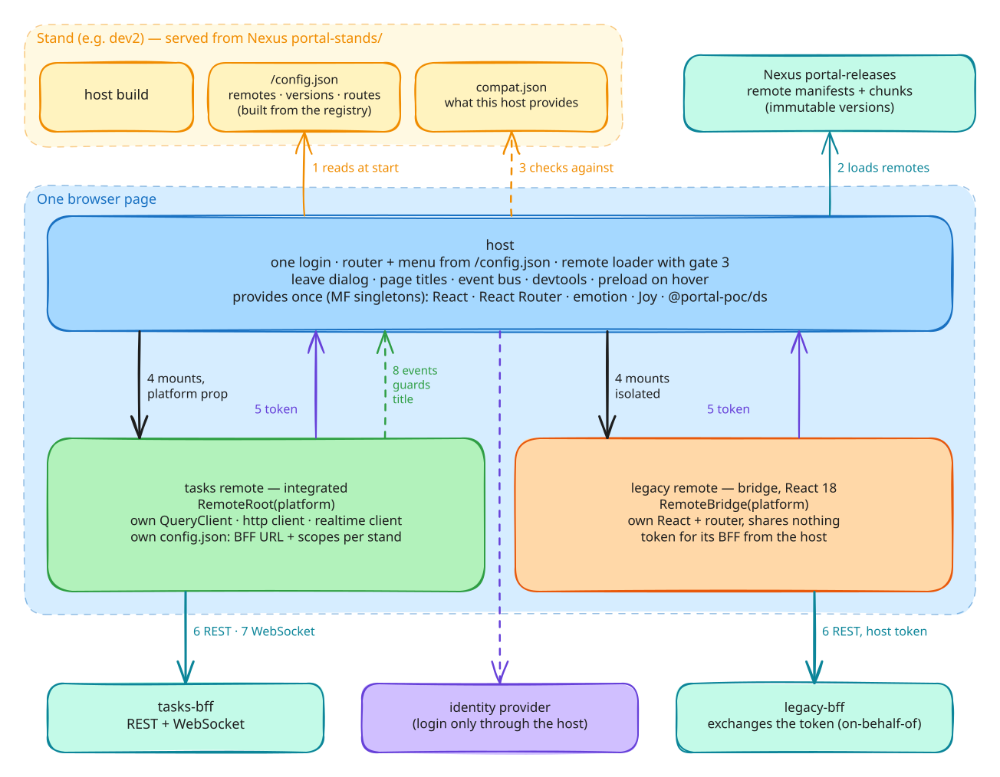

# platform

Portal micro-frontend platform (PoC, organisation [`portal-poc`](https://github.com/portal-poc)). Original requirements:
[`PORTAL_MFE_CONTEXT.md`](./PORTAL_MFE_CONTEXT.md) (deviations: architecture.md and the ADRs). Architecture and decisions: [`docs/`](./docs) (start with
[`architecture.md`](./docs/architecture.md), [`delivery.md`](./docs/delivery.md),
[`migration-plan.md`](./docs/migration-plan.md), [`adr/`](./docs/adr)). Changing a package API apps use:
[`docs/migrations.md`](./docs/migrations.md).

## Start here



Read it in the order you go through the system — stop at the step you need:

| Step | Question | Read |
|---|---|---|
| **1. Understand** | Why this, and how does it fit together? | [overview](./docs/overview.md) (three diagrams: browser flow, package × app, commit → stand) · [migration-plan](./docs/migration-plan.md) (12 problems of today → PoC answers → phases) · [differences](./docs/differences.md) (PoC vs the real project) · [ADRs](./docs/adr) (why each decision) |
| **2. Run** | Where can I see it live, and how do I run it locally? | stands: [dev3](https://dev3.poc.ashirokov.dev) (develop) · [dev2](https://dev2.poc.ashirokov.dev) (newest release) · [tst](https://tst.poc.ashirokov.dev) (business) · [run everything on one machine](#run-everything-on-one-machine) · [playbook D1–D3](./docs/playbook.md#d1-first-time-setup) (setup, a remote alone, a remote inside the host on top of any stand) · [host README](https://github.com/portal-poc/host#readme) |
| **3. Build** | How do I write a remote or a feature? | [tasks-remote README](https://github.com/portal-poc/tasks-remote#readme) (where each platform piece is used) · [package READMEs](#packages-github-packages-portal-poc-scope) · [playbook D4–D5](./docs/playbook.md#d4-a-new-remote) (new remote, everyday tasks) |
| **4. Ship** | How does it get to a stand — release, hotfix, promote, rollback? | [playbook R1–R10](./docs/playbook.md#delivery) (with marble diagrams) · [registry README](https://github.com/portal-poc/registry#readme) · [central workflows](./.github/workflows/README.md) · [branching](./docs/branching.md) · [when something goes wrong](./docs/playbook.md#when-something-goes-wrong) |
| **5. Evolve** | How do I change the platform and bring apps along? | [playbook D6–D7](./docs/playbook.md#d6-change-a-platform-package) · [migrations](./docs/migrations.md) · [cli README](./packages/portal-cli/README.md) |

## Repositories

| Repository | What | Owner in reality |
|---|---|---|
| **platform** (this) | `@portal-poc/*` packages, reusable workflows, docs | platform team |
| [host](https://github.com/portal-poc/host) | Portal host | host team |
| [tasks-remote](https://github.com/portal-poc/tasks-remote) | Remote "tasks" (FSD 2.1) | product team |
| [legacy-remote](https://github.com/portal-poc/legacy-remote) | React 18 remote via MF Bridge | another team |
| [registry](https://github.com/portal-poc/registry) | Which remote version runs on which stand (release = PR) | platform + teams (CODEOWNERS) |

## Packages (GitHub Packages, `@portal-poc` scope)

| Package | Who uses it | What for | Docs |
|---|---|---|---|
| `@portal-poc/platform-contract` | everyone (types) | The host ↔ app agreement passed as a prop: auth, env, events, telemetry, locale, devtools, navigation, document, bridge | [README](./packages/platform-contract/README.md) |
| `@portal-poc/platform-runtime` | every app, the host | Hooks over the contract (`usePlatform`, `useLeaveGuard`, `usePageTitle`), own QueryClient factory, standalone harness, devtools, stale-build reload, host-side builders | [README](./packages/platform-runtime/README.md) |
| `@portal-poc/http` | every app with a BFF | axios bound to the host's login (token, 401 retry, interaction via host), zod-validated responses | [README](./packages/http/README.md) |
| `@portal-poc/events` | apps that notify each other | Catalog of in-page events: owner + schema, validated `publishEvent` / `subscribeEvent` | [README](./packages/events/README.md) |
| `@portal-poc/realtime` | apps whose BFF pushes (opt-in) | The app's own WebSocket to its BFF with the host's token, page-owned topics, reconnect + refetch | [README](./packages/realtime/README.md) |
| `@portal-poc/ds` | every app (MF singleton) | Design system: theme, AsyncBoundary, loaders, AsyncButton, Joy re-exports | [README](./packages/ds/README.md) |
| `@portal-poc/vite-config` | every app's `vite.config.ts` | Build preset: MF section from the contract, pinned tooling, version + commit in artifacts | [README](./packages/vite-config/README.md) |
| `@portal-poc/presets` | every repository | tsconfig, oxlint (React Compiler rules, bans), fallow, Steiger, Vitest | [README](./packages/presets/README.md) |
| `@portal-poc/mf-shared` | the preset, CLI, host (not apps) | MF contract as data: exposes, singletons, ranges, compat checks | [README](./packages/mf-shared/README.md) |
| `@portal-poc/cli` (`portal-cli`) | developers, pipelines, release managers | create / add / verify / upgrade / migrate / deploy / promote / stand switch / registry | [README](./packages/portal-cli/README.md) |

Release: bump versions → run the **Release packages** workflow (or push a `v*` tag). Versions are immutable.

CI of every app repository calls the central reusable workflow
[`app-ci.yml`](./.github/workflows/app-ci.yml) pinned to `@v2` (GitHub counterpart of an Azure DevOps template).
Each `@portal-poc` package grants Read access to the app repositories (package settings → Manage Actions access).

## Run everything on one machine

1. **Token for packages** (classic PAT or `gh auth refresh -s read:packages`), then in `~/.npmrc` — it must be the
   user-level file: pnpm does not expand env vars in a repository's `.npmrc` credentials:
   ```sh
   @portal-poc:registry=https://npm.pkg.github.com
   //npm.pkg.github.com/:_authToken=<token>
   ```
2. **Clone side by side**:
   ```sh
   mkdir -p ~/projects/portal-poc && cd ~/projects/portal-poc
   for repo in platform registry host tasks-remote legacy-remote; do gh repo clone portal-poc/$repo; done
   for repo in platform registry host tasks-remote legacy-remote; do (cd $repo && pnpm install); done
   ```
3. **Infrastructure** is hosted ([ADR 0021](docs/adr/0021-hosted-poc-stands.md)): Nexus
   https://nexus.poc.ashirokov.dev, stands https://dev3.poc.ashirokov.dev (dev2, dev1, tst). Nothing to start locally.
4. **Local development** (host + the remotes you work on, everything else as deployed on dev3: the host dev server
   reads the stand's `/config.json`). Local setup lives only in `host/.env.development.local` (copy the `.example`),
   never in the registry:
   ```sh
   cd tasks-remote && pnpm dev         # :5174, listed as PORTAL_REMOTE_TASKS
   cd ../host && pnpm dev              # :5173 → http://localhost:5173
   ```
   `PORTAL_STAND=none` = only your local remotes. Or a remote standalone: `cd tasks-remote && pnpm dev:standalone`.
5. **Deploy flow** (manual: stand + ref, see [`docs/branching.md`](docs/branching.md)) — in GitHub, Actions →
   **Deploy** → Run workflow:
   - `host`: stand + ref → the host build on that stand (after `registry check`);
   - `tasks-remote` / `legacy-remote`: stand + ref → snapshot on dev3, a release on dev2 / dev1 (registry commit);
   - `registry`: **Promote** dev1 → tst; every registry change is uploaded to the stands by **Config deploy**.

   Then reload https://dev3.poc.ashirokov.dev (or dev2 / dev1 / tst). `pnpm status` in `registry` shows what runs
   where.
