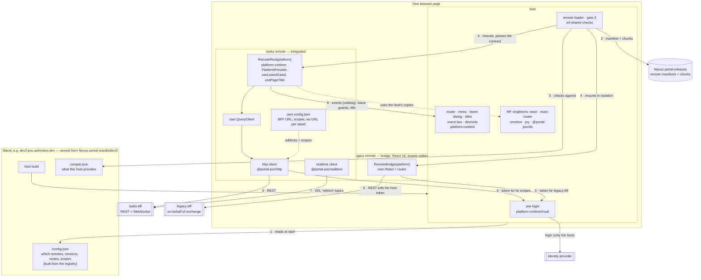
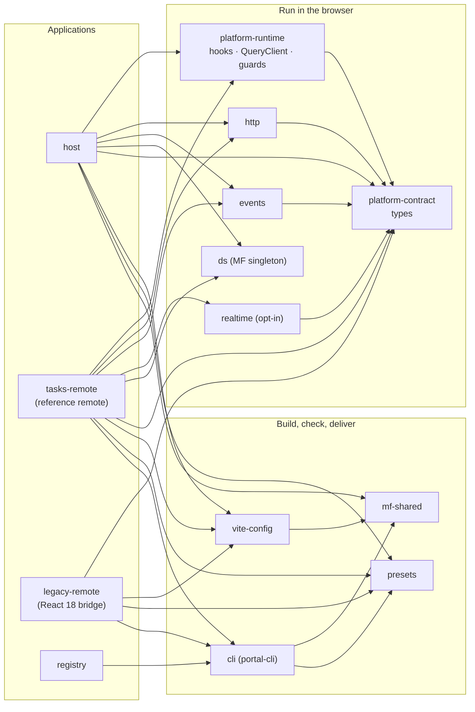
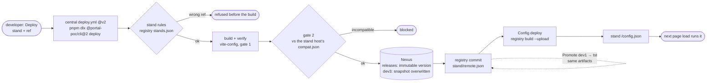

# How it fits together

Three views of the same system: what runs in the browser, which package each app uses, and how a build gets to a
stand. Start here, then follow the links to the package READMEs and the [playbook](playbook.md).

## 1. In the browser: host, remotes, packages, backends

1. The host is one build for every stand; it reads the stand's `/config.json` before rendering
   ([host README](https://github.com/portal-poc/host#readme)).
2. A remote is loaded from its manifest URL in Nexus — immutable version folder on release stands.
3. Gate 3: contract version, singletons and build tooling of the manifest are checked against this host
   ([mf-shared](../packages/mf-shared/README.md)); incompatible → the bridge build or an error inside that area only.
4. The host mounts `RemoteRoot` (integrated, shares React / router / DS) or `RemoteBridge` (own React root) and passes
   the `platform` object — the [contract](../packages/platform-contract/README.md). Nothing goes through `window`.
5. Every token comes from the host's single login, limited to the scopes in the remote's registry entry.
6. Each remote calls ITS OWN BFF with ITS OWN client and config ([http](../packages/http/README.md)); the host knows no
   BFF address. Legacy keeps its identity provider: its BFF exchanges the portal token
   ([ADR 0027](adr/0027-legacy-auth-token-exchange.md)).
7. Optional: a remote's own socket to its BFF for "refetch" notifications ([realtime](../packages/realtime/README.md)).
8. Between apps only through the platform: catalog events ([events](../packages/events/README.md)), leave guards and
   titles ([runtime](../packages/platform-runtime/README.md)).

## 2. Which package each app uses

| Package | Host | Integrated remote | Legacy (bridge) | Docs |
|---|---|---|---|---|
| platform-contract | builds the object | receives it as a prop | receives it as a prop | [README](../packages/platform-contract/README.md) |
| platform-runtime | host builders: auth per remote, leave guards, event bus, devtools, stale-build | hooks, own QueryClient, standalone | — (calls the contract directly) | [README](../packages/platform-runtime/README.md) |
| http | its own host-bff client | its BFF client | — (own client) | [README](../packages/http/README.md) |
| events | subscribes (bookmarks widget) | publishes | — | [README](../packages/events/README.md) |
| realtime | — | its BFF socket | possible (React 18 supported) | [README](../packages/realtime/README.md) |
| ds | provides the singleton | uses the host's copy | — (own UI) | [README](../packages/ds/README.md) |
| vite-config | `createHostViteConfig` → `compat.json` | `createRemoteViteConfig` → `dist/` + `dist-bridge/` | `isolated: true` | [README](../packages/vite-config/README.md) |
| mf-shared | runtime checks | (through vite-config / cli) | (through vite-config / cli) | [README](../packages/mf-shared/README.md) |
| presets | lint, TS, tests | lint, TS, tests | lint, TS, tests | [README](../packages/presets/README.md) |
| cli | (pipelines) | verify, upgrade, deploy | verify, deploy | [README](../packages/portal-cli/README.md) |

## 3. From a commit to a stand

Every scenario (feature, release, hotfix, promote, rollback, stand switch, host deploy, platform upgrade), with
marble diagrams: [playbook.md](playbook.md). Pipelines: [central workflows](../.github/workflows/README.md).
